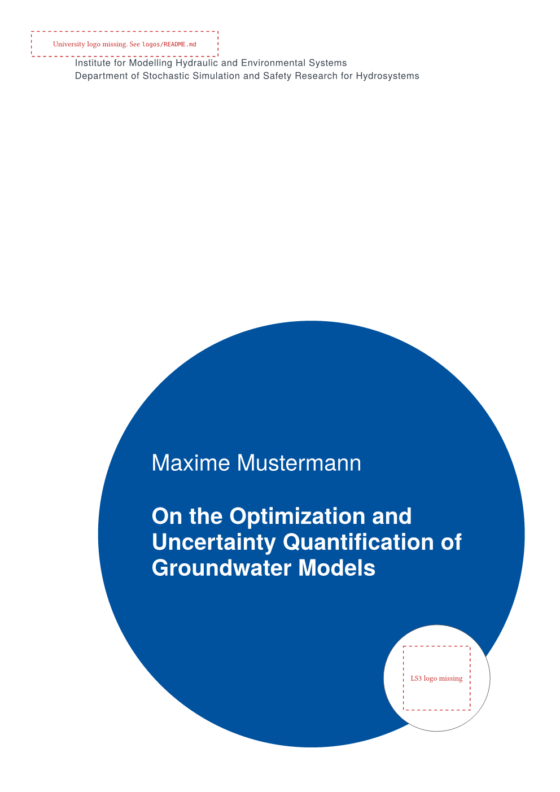

# LS3 Typst templates

Public [Typst](https://typst.app) templates of the Department of
Stochastic Simulation and Safety Research for Hydrosystems, LS3, at the
Institute for Modelling Hydraulic and Environmental Systems, University
of Stuttgart. Each template is published on
[Typst Universe](https://typst.app/universe) as its own package with its
own version.

| Template | Package | Purpose |
| --- | --- | --- |
| [thesis](thesis/) | `@preview/ls3-uni-stuttgart-thesis` | Bachelor's or master's thesis, German or English |

[](thesis/)

## Start a document

In the typst.app web app, choose "Start from template" and search for
the package name. On your own machine, run

```bash
typst init @preview/ls3-uni-stuttgart-thesis:0.1.0 my-thesis
```

Each template's README explains its parameters. The logos are not part
of the packages. The thesis README links to the official university
logo, and your supervisor gives you the LS3 logo.

## Font

The templates use TeX Gyre Heros, a free Helvetica clone. The typst.app
web app has it built in. On your own machine, install it from
[CTAN](https://ctan.org/pkg/tex-gyre-heros) or compile with
`--font-path fonts` inside this repo.

## Report a problem or contribute

Open an issue or a pull request here. [CONTRIBUTING.md](CONTRIBUTING.md)
explains how to test changes and how releases work.

## License

The templates are MIT licensed, see [LICENSE](LICENSE). The files each
template copies into a new project are under MIT-0, so your documents
carry no license obligations. The TeX Gyre Heros files in `fonts/` are
under the GUST Font License, see `fonts/LICENSE-GUST-FONT-LICENSE.txt`.
